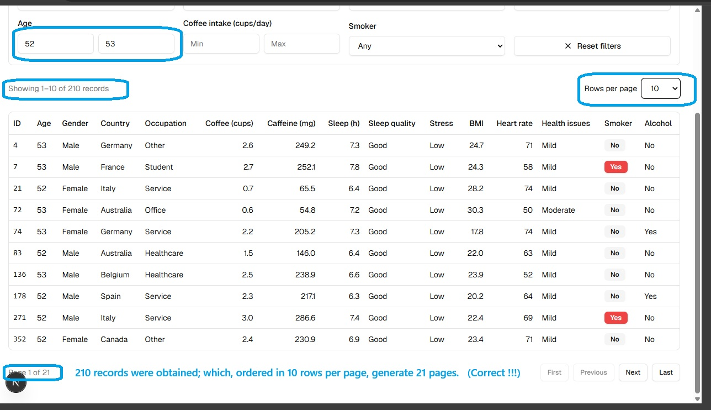
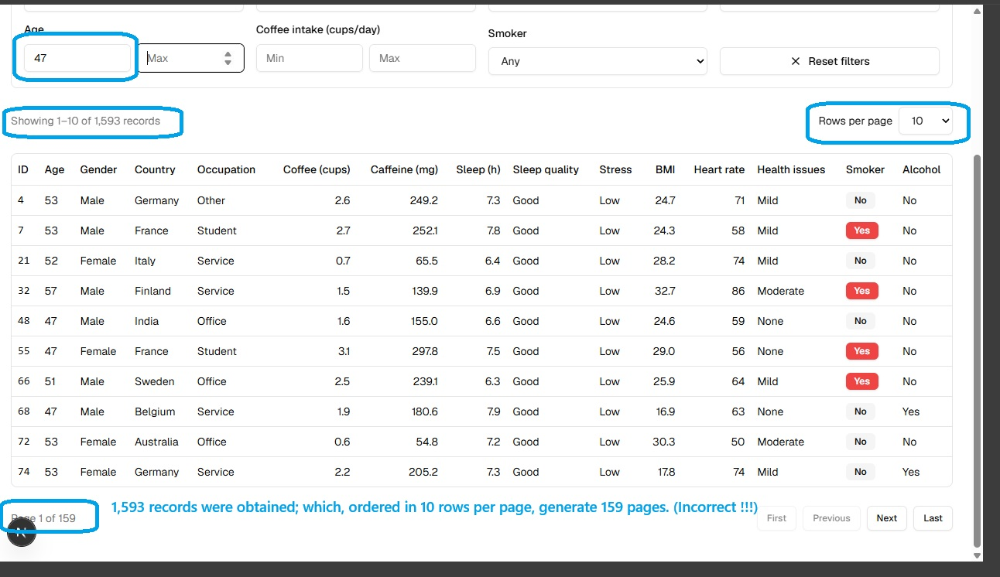
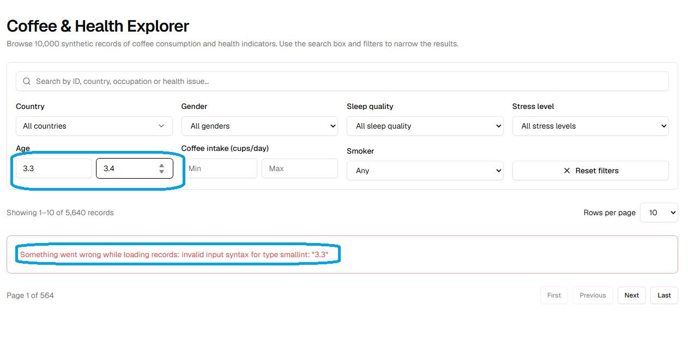
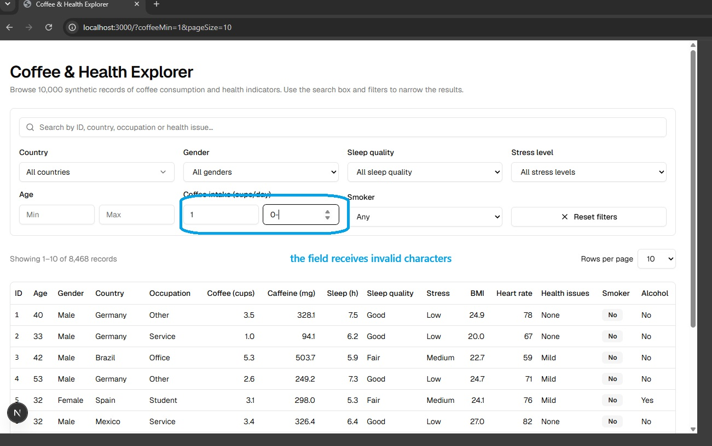
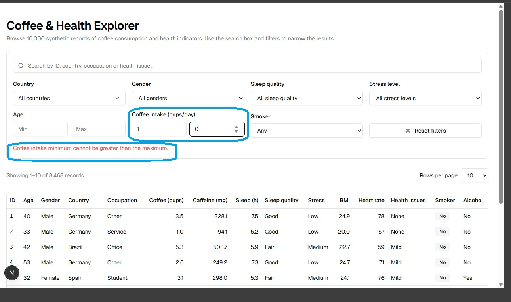
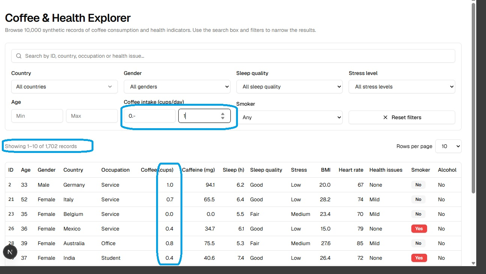

# Coffee & Health Explorer

Automated E2E tests for the Next.js + Supabase application in the exercise.

## Table of Contents

1. [Chosen tool and rationale](#1-chosen-tool-and-rationale)
2. [How to run the tests](#2-how-to-run-the-tests)
3. [Organization and coverage](#3-organization-and-coverage)
4. [What I would add with more time](#4-what-i-would-add-with-more-time)
5. [Bug reports](#5-bug-reports)

---

## 1. Chosen tool and rationale

**Playwright** (`@playwright/test`, TypeScript), running on Chromium.

- It automatically waits for elements to be ready, reducing flaky tests in an app with loading states.
- It can intercept the API (`page.route`), which is useful for testing loading states deterministically.
- It generates screenshots and traces when a test fails; these serve as evidence in bug reports.
- It uses TypeScript, the same language as the project, so it does not introduce another runtime.
- Its configuration starts the app automatically (`webServer`) and reuses the server if it is already running.
- It allows multiple browser contexts within a single test, which is necessary for testing shared links (deep links) in a clean browser.

---

## 2. How to run the tests

### Quick start

Requirements (same as the exercise README): Node.js 24+, pnpm 10+, Docker running, and port 3000 free. `package.json` and `playwright.config.ts` are already configured in this repository, so there is nothing to set up besides the steps below.

```bash
git clone <repository-url>
cd next-supabase-qa-take-home
./setup.sh                              # once: installs dependencies, starts Supabase, loads the 10,000 rows
pnpm exec playwright install chromium   # once: downloads the test browser
pnpm test:e2e                           # Playwright starts the app by itself
pnpm test:e2e:report                    # optional: opens the HTML report
```

On Windows, run `./setup.sh` from Git Bash or WSL 2.

**Expected result:** 90 tests, **85 pass and 5 fail**. The 5 failures are intentional: they are all in `pagination.spec.ts` and expose [BUG-001](#bug-001-page-count-is-not-calculated-correctly) (see section 5). Because of them, `pnpm test:e2e` exits with a non-zero code. Any other failure is unexpected.

One of the 85 passing tests is the known failure for [BUG-002](#bug-002-age-filter-accepts-decimals-and-shows-a-raw-database-error): it is marked with `test.fail()`, so Playwright reports it as passed *because* it fails. Once BUG-002 is fixed, that test is reported as an unexpected pass and the `test.fail()` line must be removed.

If Supabase is not running (after `pnpm stop`, a Docker restart or a reboot), run `./setup.sh` again. It is safe to repeat and leaves the database in a clean state.

### Commands

| Command | What it does |
| --- | --- |
| `pnpm test:e2e` | Runs all tests without a visible browser window (headless), one worker at a time |
| `pnpm test:e2e:headed` | Runs tests with the browser visible (useful to follow the test by eye) |
| `SLOWMO=1000 pnpm test:e2e:headed` | Same, with a different pause after every action (see *Configuration*; macOS/Linux/Git Bash syntax) |
| `pnpm test:e2e:ui` | Opens Playwright's interactive mode |
| `pnpm test:e2e:report` | Opens the latest HTML report |
| `pnpm exec playwright test e2e/tests/pagination.spec.ts` | Runs a single file |
| `pnpm exec playwright test -g "Next shows rows"` | Runs tests whose names match the expression |

### Configuration and environment variables

No environment variables are needed to run the suite. The relevant settings live in `playwright.config.ts`:

- `workers: 1` and `fullyParallel: false`: tests run one at a time (see *Single worker* below).
- `slowMo`: a pause after every browser action, in all runs (headless and headed). It defaults to **500 ms** and can be changed with the optional `SLOWMO` variable (for example `SLOWMO=1000 pnpm test:e2e:headed`). The default is intentional, not cosmetic: see *Known limitation: the debounce* in section 3 before lowering it.
- `timeout: 30_000`: maximum time per test.
- `webServer`: starts `pnpm dev:next` and waits up to 120 s for it to respond (the first Next.js compilation can be slow). It reuses the server if port 3000 is already in use.

Optional: the app has its own `API_DELAY_MS` variable (see the exercise README) to slow down the API. The suite does not need it, because the loading tests hold the API response themselves (`holdApi`). If you want to use it, start the app yourself in one terminal (`API_DELAY_MS=1500 pnpm dev:next`) and run `pnpm test:e2e` in another; Playwright reuses the server on port 3000. In Windows `cmd` and PowerShell, set the variable with `set API_DELAY_MS=1500&&` or `$env:API_DELAY_MS=1500;` respectively.

### Notes and troubleshooting

- **You do not need to start the app beforehand.** Playwright runs `pnpm dev:next` on its own (`webServer`). If the app is already running on port 3000, it reuses it.
- **Supabase must be running.** Playwright only starts the Next.js app, not the database. If `/api/records` fails, check that the Supabase containers are up (`docker ps`) or run `./setup.sh` again.
- **Missing `.env.local`.** `/api/records` returns 500 with the error "Your project's URL and Key are required". Run `./setup.sh` and restart the app to fix it.
- **Use `localhost`.** Opening the app through the network IP (for example, `192.168.x.x:3000`) causes "cross-origin" warnings in development. The tests use `localhost`.
- **Text assertions.** The summary uses a thousands separator (`10,000`) and an en dash (`1–25`), not a regular hyphen. Text assertions must match this.
- **Single worker.** The configuration sets `workers: 1`. The Next.js development server compiles on demand, and with several workers hitting `/api/records` at the same time the tests became unstable (timeouts and timing-dependent failures). Running them one at a time is slower but deterministic.
- **Slow motion is on by default.** `slowMo` is 500 ms unless `SLOWMO` says otherwise. It makes the full run slower and is applied in headless mode too. Setting `SLOWMO=0` may make some tests flaky (see section 3).
- **`pnpm test` is not the E2E suite.** `pnpm test` and `pnpm test:run` run the project's Vitest unit tests; E2E tests are run only with `pnpm test:e2e`. If Vitest ever picks up files from `e2e/`, exclude them in the Vitest configuration (`exclude: ["e2e/**"]`).
- **Where to look when a test fails.** `pnpm test:e2e:report` opens the HTML report with every test (passed and failed); screenshots, traces and `error-context.md` are kept only for failed tests under `test-results/`. Both `test-results/` and `playwright-report/` are ignored by git and are overwritten on each run. Evidence for bug reports is saved in `e2e/evidence/`.

---

## 3. Organization and coverage

### Pattern: Component-based Page Object Model + fixtures

The app has **a single page** (`/`). Instead of one giant class, a *Page Object* is used **for each UI component**, and these are composed into a main page. Each layer has a single responsibility:

| Layer | Responsibility |
| --- | --- |
| `tests/` | **What** is verified (the assertions) |
| `pages/` | **How** the UI is interacted with (locators and actions) |
| `fixtures/` | Shared setup (opening the app and waiting for the initial load) |
| `support/` | Non-UI utilities (constants, network, text parsing) |

```text
playwright.config.ts                  # baseURL, testDir, screenshots/traces, webServer
e2e/
  tests/
    initial-load.spec.ts              # initial load: rows, sorting, skeleton, ready table
    search.spec.ts                     # search
    filters.spec.ts                    # filters, validation, combination, reset
    pagination.spec.ts                 # pagination
    loading.spec.ts                   # loading indicator and aria-busy on each request
    url-state.spec.ts                 # URL state
  pages/
    ExplorerPage.ts                   # composes the components; goto, URL, view snapshot
    components/
      SearchBox.ts                    # search box
      Filters.ts                      # selects, country, numeric ranges, validation, reset
      ResultsTable.ts                 # rows, cells by column, skeleton, empty state, error message
      Pagination.ts                   # buttons, page size, summary, indicator
      LoadingState.ts                 # "Loading…" indicator, aria-busy, opacity
  fixtures/
    test.ts                           # `explorer` and `freshExplorer` fixtures
  support/
    constants.ts                      # data-testid, totals and limits (single source of truth)
    parsers.ts                        # parsing "Showing X–Y of Z" and "Page N of M"
    network.ts                        # holdApi, trackApiRequests
    select.ts                         # chooseOption (native select or Radix/shadcn)
    flows.ts                          # buildComplexView (view with search + filters + page)
  evidence/                           # screenshots used in the bug reports (section 5)
```

### Design rules

1. **Assertions (`expect`) belong in tests**, not in page objects. The POM exposes locators and actions; the test determines what is expected. The only exception is `waitUntilIdle()`, which is a wait, not an assertion.
2. **Keep all `data-testid` values in one place**: `support/constants.ts`. If an identifier changes in the app, update it there and nowhere else.
3. **Use fixtures instead of repeated `beforeEach` blocks.** `explorer` provides the app already open and with its initial load complete. `freshExplorer` provides the page object *without* navigating, for tests that need to prepare the network first (for example, `holdApi` before `goto`).
4. **Prefer state-based waits** (`aria-busy`, `loading-indicator`) over fixed delays. There are two documented exceptions: `DEBOUNCE_GRACE_MS`, which is needed to prove that *no* request is sent, and the global `slowMo` (see *Known limitation: the debounce* below).
5. **Read expected values from the UI itself** (for example, the first value in a column) whenever possible, to avoid depending on seed data.
6. **Methods that wait vs. direct locators.** `goNext()`, `goLast()`, `setPageSize()`… wait for loading to finish. To observe the loading state, use direct locators (`pagination.next.click()`), which do not wait.
7. **Known bugs remain visible in the test**, referenced by their ID in the test title (for example `[BUG-001]`) and in a `KNOWN FAILURE` comment, rather than being hidden in the page object. BUG-001 tests fail on purpose; the BUG-002 test is marked with `test.fail()`.

### Known limitation: the debounce

Search and numeric filters are sent to the API after a debounce. `waitForResults()` only observes the loading state (no indicator, no `aria-busy`), so if it is called immediately after `fill()` it can resolve **before** the debounced request has started. The suite currently covers that gap with `slowMo` (500 ms after each action), which gives the request time to start. This is why the default is not 0 and why lowering `SLOWMO` can make tests flaky. The proper fix is described in section 4: make `waitForResults()` wait for the actual `/api/records` response.

### Test example

```ts
test("Next shows rows 26–50, updates summary and indicator", async ({ explorer }) => {
  await explorer.pagination.goNext();

  await expect(explorer.pagination.summary).toHaveText(
    "Showing 26–50 of 10,000 records",
  );
  expect(await explorer.pagination.readIndicator()).toEqual({ current: 2, pages: 400 });
});
```

### How to add a new test

1. Does it need a new UI element? Add its `data-testid` to `support/constants.ts` and its locator to the relevant component.
2. Is it a reusable action (multiple steps used in more than one test)? Add a method to the component, or to `support/flows.ts` if it spans multiple components.
3. Write the test in the relevant spec file, using the `explorer` fixture and keeping the assertions inside the test.

### Coverage status

Legend: ✅ implemented · ⚠️ partial · ⏳ pending

| Area | What is tested | File | Status |
| --- | --- | --- | --- |
| Initial load | 25 rows and summary "Showing 1–25 of 10,000 records" | `initial-load` | ✅ |
| Initial load | Ascending ID order (IDs 1–25) | `initial-load` | ✅ |
| Initial load | Skeleton rows and "Loading records…" until data arrives; table ready with no loading state | `initial-load` | ✅ |
| Loading indicator | "Loading…", `aria-busy="true"`, dimmed table and disabled pagination on every request (search, filters, page, rows per page, reset) | `loading` | ✅ |
| Search | Text (country, occupation, partial), ID, case-insensitivity, no results, clear | `search` | ✅ |
| Filters | Each filter individually, inclusive ranges, limits 0–130 and 0–20, validation messages, no request for invalid data | `filters` | ✅ |
| Filters | Combination with search (AND) and Reset filters | `filters` | ✅ |
| Filters | Decimal values in Age (no database error) | `filters` | ✅ known failure, `test.fail()` (BUG-002) |
| Filters | Invalid characters in Age and Coffee intake (outside the specification) | — | ⏳ (BUG-003) |
| Pagination | Next/Previous, First/Last, button states, summary and indicator | `pagination` | ✅ |
| Pagination | Page size (10/25/50/100) and reset to page 1 | `pagination` | ✅ |
| Pagination | Page count with filtered totals (4 runs) and access to all records (1 test) | `pagination` | ✅ (5 fail: BUG-001) |
| Pagination | Reset to page 1 when search or any filter changes | `pagination` | ✅ |
| URL state | URL reflects the view; Reset clears it | `url-state` | ✅ |
| URL state | Reload and direct links (complex view, page, rows per page) | `url-state` | ✅ |
| Empty state | Message "No records match your search and filters." | `search` | ✅ |
| Error state | Error message when the API fails (`page.route`) | — | ⏳ |

### Test details

Summary: **90 tests** across 6 files (**85 pass, 5 fail on purpose** because of BUG-001; the failing ones are in `pagination.spec.ts`). Test names are in English, as they appear in the Playwright report. Tests marked *(loop)* run once for each specified value. Tests that expose a bug carry its ID in the title (`[BUG-001]`, `[BUG-002]`).

#### `initial-load.spec.ts` (4 tests)

| Test | Description |
| --- | --- |
| shows 25 rows and the full summary | Opening `/` displays exactly 25 rows and the summary says "Showing 1–25 of 10,000 records". |
| rows are ordered by ID ascending, starting at 1 | Reads the `data-row-id` from the 25 rows and verifies that the IDs are 1 through 25 in ascending order. |
| shows skeleton rows and 'Loading records…' until the data arrives | Holds the API response: while it is pending, the summary says "Loading records…", skeleton rows are visible, and no real rows are present. Once released, 25 rows appear and the skeletons disappear. |
| the table is ready to use once loaded: no loading or busy state | Once data is loaded, there is no "Loading…" indicator, no `aria-busy="true"` remains, and the Next button is enabled. |

#### `search.spec.ts` (8 tests)

| Test | Description |
| --- | --- |
| by country returns only rows from that country | Searching for "Japan" returns only rows whose country contains "japan". |
| by occupation matches the occupation column | Searches for an occupation taken from the first row and verifies that every returned row contains it (without relying on fixed data). |
| a partial match also returns results | Searching for "apan" returns rows whose country contains that partial text. |
| an integer matches the record with that ID | Searching for "42" displays the row with `data-row-id="42"`. |
| lowercase and uppercase queries give the same summary | "japan" and "JAPAN" produce the same results summary (case-insensitive search). |
| shows the empty state | A query with no matches displays "No records match your search and filters." and no rows. |
| restores all 10,000 records | After searching and clearing the text, the full summary and all 25 rows return. |
| after an empty state, the table is shown again | After an empty state, clearing the search hides the message and restores the table. |

#### `filters.spec.ts` (27 tests)

**Each filter individually**

| Test | Description |
| --- | --- |
| gender / sleep quality / stress level / smoking keeps only matching rows *(loop, 4)* | Selects an actual value from the first row and verifies that all resulting rows have that value in the corresponding column. |
| country: a single country keeps only rows from that country | Selects one country and verifies that all rows belong to it. |
| country: multiple countries show rows from any of them | Selects two countries and verifies that every row belongs to either one (multi-select). |
| age: min and max are inclusive | With min = max = the first row's age, every row has exactly that age (both bounds are inclusive). |
| age: only a minimum (empty max) is accepted | Minimum 60 only: no validation message, and all ages are ≥ 60. |
| age: only a maximum (empty min) is accepted | Maximum 25 only: no validation message, and all ages are ≤ 25. |
| coffee intake: min and max are inclusive | Same as age, but for coffee intake. |
| age: a decimal value within range does not cause an error [BUG-002] | Age min `3.3` and max `3.4` are within 0–130, so the request must run and the empty state must be shown, with no error message. **Known failure:** marked with `test.fail()` until BUG-002 is fixed. |

**Numeric limits and validation**

| Test | Description |
| --- | --- |
| age 0–130 are valid limits | Age 0–130 is valid: no message, and all 10,000 records remain. |
| coffee intake 0–20 are valid limits | Coffee intake 0–20 is valid: no message, and all 10,000 records remain. |
| age below 0 / age above 130 / coffee intake below 0 / coffee intake above 20 shows a validation message and sends no request *(loop, 4)* | An out-of-range value displays a validation message and no request is sent to `/api/records` (requests are counted after waiting for the debounce). |
| age min greater than max shows a validation message and sends no request | An age minimum greater than the maximum displays a validation message and sends no request. |
| coffee min greater than max shows a validation message and sends no request | Same behavior for coffee intake. |
| fixing an invalid value clears the message and updates results | Correcting an invalid value removes the message and updates the results. |

**Combining filters with search**

| Test | Description |
| --- | --- |
| search and a filter are combined with AND | Search "Japan" + gender: every row meets both conditions, and the filtered total is greater than 0 and not larger than the total of the search alone. |
| several filters combined with search all apply together | Search + gender + minimum age 30: every row meets all three conditions. |
| filters that exclude everything show the empty state | A search with no matches combined with a filter displays the empty state. |

**Reset filters**

| Test | Description |
| --- | --- |
| is disabled when there are no filters | With no filters or search, the button is disabled. |
| is enabled once a filter or search is applied | The button becomes enabled after applying a filter. |
| clears search and all filters and restores the full list | After applying a search and several filters, Reset clears the fields, restores the full summary, and becomes disabled again. |
| returns to page 1 from a later page | Applies a filter first (which resets the page), then moves to page 2 and checks it; Reset then restores the full summary and returns to page 1. |

#### `pagination.spec.ts` (24 tests)

**Navigating between pages**

| Test | Description |
| --- | --- |
| Next shows rows 26–50, updates summary and indicator | Next navigates to "Showing 26–50…", "Page 2 of 400", and 25 rows with IDs 26 through 50. |
| Previous goes back to the previous page | Previous returns to page 1 with the original summary and first ID. |
| consecutive pages do not repeat or skip records | Pages 1–3 together contain IDs 1 through 75, with no duplicates or gaps. |
| rows stay sorted by ID ascending on later pages | ID order remains ascending on subsequent pages. |

**First and last page**

| Test | Description |
| --- | --- |
| on page 1, First and Previous are disabled; Next and Last enabled | Verifies the state of all four buttons on page 1 and the "Page 1 of 400" indicator. |
| Last goes to page 400 with the final 25 records | Last navigates to "Page 400 of 400", summary "9,976–10,000", and IDs 9976 through 10000. |
| on the last page, Next and Last are disabled; First and Previous enabled | Verifies the button states on the last page. |
| First returns to page 1 from the last page | First returns to page 1 from the last page. |
| with a single page of results, all four buttons are disabled | With a single result (search "42"), the indicator is "Page 1 of 1" and all four buttons are disabled. |

**Rows per page**

| Test | Description |
| --- | --- |
| 10 / 25 / 50 / 100 per page: row count, summary and total pages *(loop, 4)* | For each size: row count, summary "Showing 1–N of 10,000", and total page count (1000, 400, 200, 100). |
| changing page size returns to page 1 | When on page 3, changing to 50 rows returns to page 1. |
| last page with 100 per page shows records 9,901–10,000 | Last page with 100 rows: summary "9,901–10,000" and page 100. |

**Summary and indicator consistency with filtered totals**

| Test | Description |
| --- | --- |
| filtered results, 10 / 25 / 50 / 100 per page: pages = ceil(total / size) and last page has the remainder [BUG-001] *(loop, 4)* | With minimum age 47, the total page count must be `ceil(total / size)` and the last page must show the remaining records through the total. **Exposes BUG-001.** |
| every matching record is reachable: walking all pages yields each ID exactly once [BUG-001] | With a country filter and 100 rows per page, navigates through all pages and verifies that each ID appears exactly once and that every matching record is reached. **Exposes BUG-001.** |

**Resetting the page**

| Test | Description |
| --- | --- |
| changing a numeric filter returns to page 1 | From page 3, changing the minimum age returns to page 1. |
| changing a select filter returns to page 1 | Same behavior when changing a single-select filter. |
| changing the country filter returns to page 1 | Same behavior when changing the country filter. |
| changing the search returns to page 1 | Same behavior when changing the search. |

The loading state of the pagination buttons is covered in `loading.spec.ts`. An earlier test in this file that duplicated it with a fixed 3-second API delay was removed.

#### `url-state.spec.ts` (16 tests)

**The URL reflects the current view**

| Test | Description |
| --- | --- |
| default view has no query string state | The default view has no query-string parameters other than the pagination defaults (`page`, `pageSize`, listed in `NEUTRAL_URL_PARAMS`). |
| search is written to the query string | Searching for "Japan" adds a parameter whose value is exactly `Japan`. |
| a filter is written to the query string | Applying a minimum age of 60 adds a parameter whose value is exactly `60`. |
| page and rows per page are written to the query string | Choosing 50 rows per page adds a parameter whose value is exactly `50`; moving to the next page changes the URL. |
| reset filters clears the state from the URL | After Reset, no parameter value is `Japan` or `30`. |

The URL tests compare exact parameter **values** (`explorer.urlParamValues()`), not substrings, and do not depend on the parameter names.

**Reloading the page** (a complete snapshot of the state before and after is compared using `explorer.snapshot()`: summary, indicator, row IDs, and field values)

| Test | Description |
| --- | --- |
| restores search | Reloading preserves the search and its results. |
| restores a numeric range | Reloading preserves the age range 40–50. |
| restores a select filter | Reloading preserves the gender filter. |
| restores multiple selected countries | Reloading preserves the selected countries. |
| restores the current page | Reloading on page 3 keeps the view on page 3. |
| restores rows per page | Reloading with 100 rows per page preserves the 100-row setting. |
| restores a complex view (search + filters + page + page size) | Reloading a view combining search, filters, page, and page size restores it exactly. |

**Direct links**

| Test | Description |
| --- | --- |
| opening a shared URL in a fresh browser context shows the same view | Opens the URL in a new browser context (with no previous state) and verifies that the view is identical. |
| deep link directly to a later page restores that page | A link to page 3 opens "Showing 51–75" and "Page 3". |
| a restored view can be changed and reset normally | From a view opened through a link, Reset works and restores the full list. |

**After reset**

| Test | Description |
| --- | --- |
| reloading after Reset shows the unfiltered list | After applying and resetting filters, reloading displays the unfiltered list. |

#### `loading.spec.ts` (11 tests)

All tests hold the API response (`holdApi`) to observe the loading state deterministically, without fixed delays.

| Test | Description |
| --- | --- |
| searching / changing a select filter / changing the country filter / changing a numeric filter / going to the next page / going to the last page / changing rows per page: shows "Loading…", sets aria-busy and disables pagination, then clears *(loop, 7)* | For each action: while the request is pending, the "Loading…" indicator is visible, an element has `aria-busy="true"`, and First/Previous/Next/Last are disabled; once the response arrives, the loading state clears. |
| Reset filters: shows the loading state, then restores the full list | Reset also triggers the loading state and then restores the full list. |
| the table is dimmed while loading and back to normal afterwards | While loading, the effective row opacity is less than 1; once loading finishes, it returns to 1. |
| the table keeps its rows (dimmed) while loading instead of being replaced | While loading, the previous 25 rows remain visible and the empty state does not appear. |
| pagination buttons cannot be used while loading (no double navigation) | Forcing a click on Next while loading does not skip two pages. |

#### Not yet covered

- **Error state:** an error message instead of the table when the API fails (this would be tested using `page.route` to return a 500 response).

---

## 4. What I would add with more time

- **API tests** (`GET /api/records`) to compare expected results against the UI, calculated from the seed data.
- **Expected data derived from the CSV** (`data/synthetic_coffee_health_10000.csv`) instead of fixed values.
- **Error-state test** using a mocked API (`page.route` returning 500).
- **More browsers and devices:** Firefox, WebKit, and a mobile viewport.
- **Accessibility:** roles, labels, `aria-busy`, `aria-live`.
- **CI** (GitHub Actions) with local Supabase in the pipeline.
- **Basic performance testing** using the artificial delay (`API_DELAY_MS`).
- **Browser history** (back/forward) with state stored in the URL.
- **A deterministic `waitForResults()`** that waits for the actual `/api/records` response (`page.waitForResponse` or the request counter in `network.ts`) instead of relying on `slowMo`, so the suite can run at `SLOWMO=0`.
- **Search by health issue**, which the specification lists as a searchable field and is not covered yet.
- **Single-select filters going back to "All…" / "Any"**, and **deselecting a country**.
- **Invalid URL parameters** (for example `page=999` or `pageSize=7`).
- **Debounce:** typing quickly sends a single request.
- **Exact URL parameter names** in the URL tests, once confirmed with the developers.

---

## 5. Bug reports

### Summary

| ID | Title | Severity | Area | Status |
| --- | --- | --- | --- | --- |
| [BUG-001](#bug-001-page-count-is-not-calculated-correctly) | Page count is not calculated correctly | High | Pagination | Open |
| [BUG-002](#bug-002-age-filter-accepts-decimals-and-shows-a-raw-database-error) | Age filter accepts decimals and shows a raw database error | Medium | Filters | Open |
| [BUG-003](#bug-003-numeric-filters-accept-invalid-characters-and-silently-ignore-them) | Numeric filters accept invalid characters and silently ignore them | Low | Filters | Open |

The test that exposes each bug is kept in place and carries the bug ID in its title:

- **BUG-001:** 5 tests in `pagination.spec.ts` are left failing on purpose, so the defect stays visible in every run.
- **BUG-002:** 1 test in `filters.spec.ts` is marked with `test.fail()` (a known failure). It is reported as passed while the bug exists and flags an unexpected pass once it is fixed.
- **BUG-003:** no test, because the behavior is outside the specification (see the report).

### BUG-001: Page count is not calculated correctly

| Field | Details |
| --- | --- |
| **Severity** | High |
| **Area** | Pagination |
| **Status** | Open |
| **Scope** | Confirmed with **10, 25, 50, and 100** rows per page: the page-count test failed at all four page sizes when the result count was not a multiple of the page size. A fifth test, which walks every page looking for every matching record, also fails. |
| **Tests exposing the bug** | 5 tests in `e2e/tests/pagination.spec.ts`, under *Pagination › summary and indicator stay consistent with the filtered total*:<br>1–4. *filtered results, N per page: pages = ceil(total / size) and last page has the remainder [BUG-001]* (runs for N = 10, 25, 50, and 100)<br>5. *every matching record is reachable: walking all pages yields each ID exactly once [BUG-001]* |

#### Description (in simple terms)

The table is showing fewer pages than it needs to display all the matching records. This happens when the total does not divide evenly by the selected number of rows per page.

**Simple example:** imagine there are 1,593 matching records and the table shows 10 records per page:

- 159 full pages show 1,590 records.
- 3 records are still left, so they need one more page.
- The correct total is **160 pages**, not 159.

The issue reported by this bug is that the page indicator shows one page fewer than this calculation requires. The example above explains the calculation; when reproducing the bug, use the actual total displayed by the filtered application.

#### Steps to reproduce

1. Open `http://localhost:3000`.
2. Set the rows-per-page selector to **10**.
3. Enter `47` in **Age min** and leave **Age max** empty.
4. Wait until loading finishes.
5. Read the total number of matching records in the summary (the number after `of`).
6. Read the page indicator (for example, `Page 1 of 159`).
7. Calculate the required pages: divide the total records by 10 and round **up** to the next whole number. If there is any remainder, it needs an additional page.
8. Repeat with **25**, **50**, and **100** rows per page.

#### Expected result

The page indicator must show enough pages to include every matching record. In other words:

`total pages = ceil(total matching records / rows per page)`

For the example of 1,593 records and 10 rows per page, the indicator must show **160 pages**. The final page contains the remaining 3 records.

The exercise requirements (section 4, Pagination) state that "M is the number of pages needed to show every matching record" and "Every matching record must be reachable".

#### Actual result

With 10 rows per page, the indicator shows **159** pages instead of 160. The same test also fails with 25, 50, and 100 rows per page. In addition, the test that walks all pages to reach every matching record fails, which indicates that the records on the missing last page cannot be reached through the UI.

#### Screenshot evidence

The two screenshots below make the contrast explicit. The first is a control case where the page count is correct; the second reproduces the defect with the `Age min = 47` filter.

**1. Correct calculation — 210 records / 10 rows = 21 pages.**



**2. Incorrect calculation — 1,593 records / 10 rows should be 160 pages, but the UI displays 159.**



#### Verifying the impact manually

1. Apply the filter from the steps above (`Age min = 47`) and click **Last**.
2. Check the summary: its ending number should equal the total number of matching records.
3. If it ends earlier, or the final records cannot be reached, the missing last page is confirmed as unreachable.

#### Acceptance criteria

- [ ] With any filter or search, the indicator's total page count M equals `ceil(Z / N)` for N = 10, 25, 50, and 100.
- [ ] When Z is not a multiple of N, the last page exists and displays exactly `Z - (M - 1) * N` rows.
- [ ] On the last page, the summary is "Showing X–Z of Z records", with Z as the final value.
- [ ] All matching records are reachable: navigating through all pages displays each ID exactly once.
- [ ] Next and Last are disabled only on the actual last page (M), and First and Previous only on page 1.
- [ ] With no filters (10,000 records), behavior remains unchanged: 1000, 400, 200, and 100 pages for 10, 25, 50, and 100 rows.
- [ ] All five tests exposing the bug pass: the four runs of the page-count test (10, 25, 50, and 100) and *every matching record is reachable*.

#### Test failure evidence

Playwright also saves a failure screenshot under `test-results/`. The folder name is based on the test file and title, so its exact path may change. A typical path looks like:

`test-results/pagination-...-last-page-has-the-remainder-bug-001-chromium/test-failed-1.png`

---

### BUG-002: Age filter accepts decimals and shows a raw database error

| Field | Details |
| --- | --- |
| **Severity** | Medium |
| **Area** | Filters (Age min / Age max) · Error handling |
| **Status** | Open |
| **Scope** | Age fields (min and max). Coffee intake is not affected: decimals work there (for example `0.5` cups). |
| **Related** | [BUG-003](#bug-003-numeric-filters-accept-invalid-characters-and-silently-ignore-them) covers invalid characters (for example `3-3`), which is a different cause and is outside the specification. |
| **Discovered by** | Manual exploratory testing, now also covered by an automated known-failure test. |
| **Test exposing the bug** | `e2e/tests/filters.spec.ts`, under *Filters › each filter on its own*: *age: a decimal value within range does not cause an error [BUG-002]*. It is marked with `test.fail()`: it is reported as passed while the bug exists, and as an unexpected pass once the bug is fixed (then remove the `test.fail()` line). |

#### Description

A decimal age such as `3.3` is a value **within the allowed range** (0–130), yet the app fails. Age is stored as an integer (`smallint`) in the database, and the app sends the typed value as-is, so the database rejects the query and the **raw database error** is shown to the user instead of results:

`Something went wrong while loading records: invalid input syntax for type smallint: "3.3"`

According to the specification, the only reasons to reject an Age value are being out of range or a minimum greater than the maximum. A decimal within range meets neither condition, so the query should run normally.

#### Steps to reproduce

1. Open `http://localhost:3000`.
2. In **Age**, type `3.3` in the min field and `3.4` in the max field.
3. Wait for the request to finish (debounce).

#### Expected result

The exercise requirements (section 4, Age and Coffee intake) state: "Age must be 0–130 and coffee intake 0–20. If a value is out of range or the minimum is greater than the maximum, a validation message appears and no request is sent."

`3.3` and `3.4` are within 0–130 and the minimum is not greater than the maximum, so no validation message applies and the request must be sent. The filter is then evaluated numerically: since no whole age lies between 3.3 and 3.4, the table should show the empty state *"No records match your search and filters."*. A single decimal bound (for example min `3.5`) should return the records with age ≥ 3.5 (that is, 4 or more).

*Acceptable alternative:* if the team decides decimals are not valid ages, the app must show a validation message and send no request. The specification does not state this rule, so it would need to be defined first.

#### Actual result

A red error box appears with `invalid input syntax for type smallint: "3.3"` and no rows are shown. The error state replaces the table; the specification only expects this when the API fails, and here the API fails because of an input the specification considers valid.

#### Additional observations

- The summary (`Showing 1–10 of 5,640 records`, `Page 1 of 564`) and the pagination buttons keep the values of the previous successful request while the error is displayed. The user sees stale counts next to the error.
- The raw message exposes internal details (column type, query error) to the end user.

#### Screenshot evidence

**Decimals `3.3` / `3.4` produce a smallint error from the database.**



#### Acceptance criteria

- [ ] Typing a decimal within range (for example `3.3`) in Age min or Age max does not produce an error; the request is sent and the results are filtered numerically (empty state when nothing matches).
- [ ] Or, if the team defines that decimals are invalid: a validation message is shown and no request is sent to `/api/records`.
- [ ] No raw database error text is ever displayed to the user; a generic message is shown instead.
- [ ] When an error occurs, the summary and pagination do not show stale counts from a previous request.
- [ ] Valid integer ages (0–130), inclusive ranges, and empty min/max keep working as before.
- [ ] The test exposing the bug passes without the `test.fail()` marker (remove that line once the bug is fixed).

---

### BUG-003: Numeric filters accept invalid characters and silently ignore them

| Field | Details |
| --- | --- |
| **Severity** | Low |
| **Area** | Filters (Age and Coffee intake, min and max) · Usability / input feedback |
| **Status** | Open |
| **Type** | Usability observation. The behavior is **not defined by the specification** (see "Specification" below). |
| **Scope** | Confirmed in **Age** (min and max, with `3-3` / `3-4`) and in **Coffee intake** (max with `0-`, min with `0.-`). |
| **Related** | [BUG-002](#bug-002-age-filter-accepts-decimals-and-shows-a-raw-database-error) covers decimals in Age (database error), which is a different cause and does contradict the specification. |
| **Discovered by** | Manual exploratory testing. No automated test covers it yet. |
| **Test exposing the bug** | Not required: the behavior is outside the specification. If one is added, mark it `test.fixme()` and reference `BUG-003`. |

#### Specification

The requirements only define two validation cases for the numeric filters (out of range, and minimum greater than maximum) and state that either bound can be left empty. They do not say what to do with text that is not a number. The behavior below is therefore reported as a usability problem, not as a deviation from the table in section 4.

#### Description

The numeric filter fields accept characters that are not part of a valid number (for example `3-3`, `0-` or `0.-`) and the app gives no feedback. The malformed value is silently discarded and the filter is applied as if that field were empty. The user believes a range was applied, but it was not.

The clearest proof is in Coffee intake, comparing two cases with the same minimum (`1`):

- **Control:** min `1`, max `0` (valid number, but inconsistent). The app shows *"Coffee intake minimum cannot be greater than the maximum."* and sends no new request, as the specification requires.
- **Case:** min `1`, max `0-` (invalid characters). The app shows **no message**, the URL keeps only `coffeeMin=1` (the maximum is dropped from the state), and the summary shows the same `8,468 records` as with the minimum alone. If the maximum had been read as `0`, the min > max message would have appeared, as in the control.

In Age the effect is the same and more visible: with `3-3` / `3-4` the table returns **all 10,000 records**, with ages (29, 32, 33, 40, 53…) far outside the typed range.

> **Hypothesis (to confirm with the developers):** a `type="number"` input lets the user type invalid characters, but reports an empty value to the app, which the app correctly treats as "empty bound". This is consistent with the specification ("either can be left empty"), which is why it is classified as a usability observation.

#### Steps to reproduce

**Case A: Age**

1. Open `http://localhost:3000/?pageSize=10`.
2. In **Age**, type `3-3` in the min field and `3-4` in the max field.
3. Wait for the request to finish.
4. Observe: no message, and `Showing 1–10 of 10,000 records` with ages outside 3–4.

**Case B: Coffee intake (with control)**

1. Open `http://localhost:3000`.
2. In **Coffee intake (cups/day)**, type `1` in the min field and wait for the results (`8,468 records`).
3. In the max field, type `0-` and wait for the debounce.
4. Observe: the field keeps the invalid characters, there is no validation message, the URL is still `?coffeeMin=1&pageSize=10` and the summary still shows `8,468 records`.
5. **Control:** replace `0-` with `0`. The message *"Coffee intake minimum cannot be greater than the maximum."* appears.

**Variant:** min `0.-` and max `1` in Coffee intake returns `1,702 records` with no message. Since all coffee values are ≥ 0, this case alone cannot show whether the minimum is ignored; Case B can.

#### Expected result (recommendation)

The fields should not accept characters that are not part of a valid number or, if they accept them, should show a message next to the field so the user knows the value was not applied. The specification does not require this; it is a recommended improvement.

#### Actual result

| Case | Input | What happens |
| --- | --- | --- |
| A | Age min `3-3`, max `3-4` | No message. 10,000 records, ages outside the range. |
| B | Coffee min `1`, max `0-` | No message. Maximum dropped from the URL. 8,468 records (minimum only). |
| Variant | Coffee min `0.-`, max `1` | No message. 1,702 records. |

#### Screenshot evidence

**1. Case A: Age `3-3` / `3-4`. The filter is ignored and the table returns all 10,000 records with ages outside the range.**


**2. Case B: Coffee max `0-`. No message; URL has only `coffeeMin=1`; 8,468 records, the same as with the minimum alone.**



**3. Control: Coffee max `0` (valid) with min `1` shows the min > max message.**



**4. Variant: Coffee min `0.-` and max `1`, no message, 1,702 records.**



#### Acceptance criteria

- [ ] The Age and Coffee intake fields do not accept invalid characters (such as `-` after a digit, or `0.-`), or they show a message telling the user the value was not applied.
- [ ] A malformed value is never silently treated as "no filter" without any feedback.
- [ ] Valid values (for example `0.5`, `2.5` in Coffee intake; integers 0–130 in Age), inclusive ranges, and empty min/max keep working as before.
